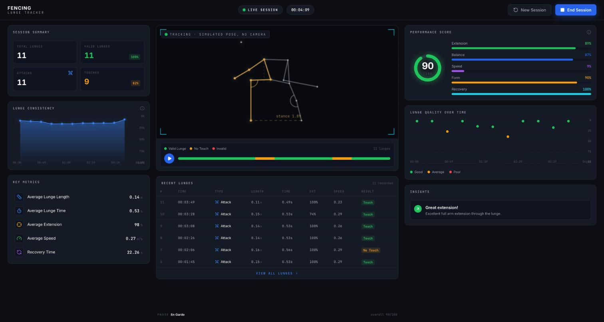
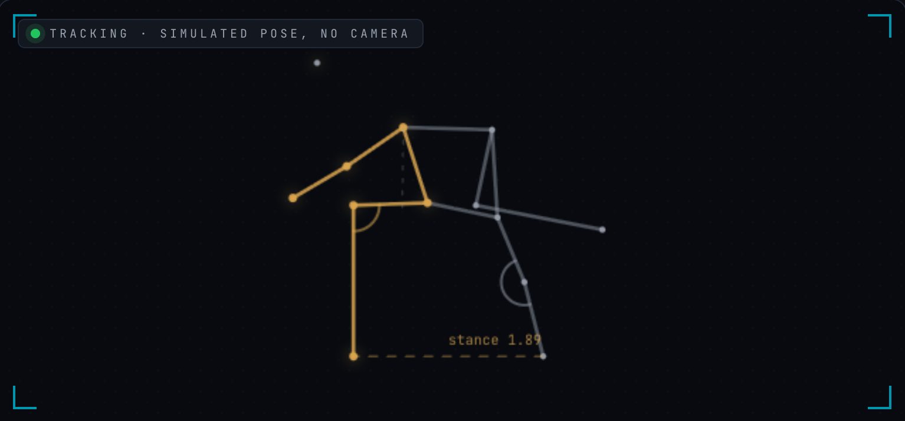
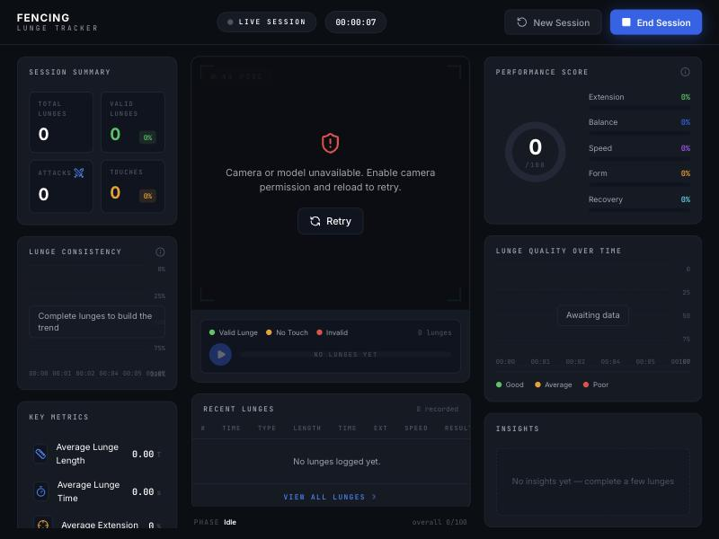

# Épée Lunge Tracker


> [!NOTE]
> A working prototype that runs **entirely in your browser** — no account, no server, and your video never
> leaves your device. Try it at **[aydxb09.github.io/fencing-lunge-tracker](https://aydxb09.github.io/fencing-lunge-tracker/)**
> (it needs a webcam). The detection rules are hand-tuned and have **not** been validated against real
> footage or a coach — see [Honest limits](#honest-limits).

## Table of contents
- [What it is](#what-it-is)
- [Screenshots](#screenshots)
- [Core features](#core-features)
- [Real examples](#real-examples)
- [How it works — the key technical choice](#how-it-works--the-key-technical-choice)
- [Tech stack](#tech-stack)
- [Privacy](#privacy)
- [Honest limits](#honest-limits)
- [Project layout](#project-layout)
- [Running locally](#running-locally)
- [License](#license)

## What it is

Épée fencers train the lunge thousands of times, usually with a coach watching — or alone, with no
feedback at all. This app turns a laptop webcam into a lunge coach: it **detects each lunge, measures how
fast it was, scores the technique out of 100, and tells you which specific thing to fix** ("weapon arm is
late", "front foot lifts off the floor"), while a live dashboard tracks your consistency across the session.

Everything runs on-device: a pose-estimation model finds your joints in each video frame, and a hand-written
state machine turns those joints into lunges and cues.

## Screenshots

**Session dashboard** — session totals, a 0–100 performance score with five skill bars, lunge consistency
and quality over time, and a table of recent lunges. *This capture is a simulated session: 11 scripted
lunges (several with deliberate faults) run through the app's real analyzer — no camera and no person.
Scores, result bands and charts are genuine analyzer output; the low absolute speeds are an artifact of the
script.*


**Pose overlay** — the skeleton drawn over the video in real time: the lunging (front) side in brass, the
back side in steel, joint-angle arcs, and the live stance width. *Drawn from scripted keypoints.*


**The real app with no camera access** — empty states and zeros; no fake data is shown.


## Core features

- **Lunge detection that ignores non-lunges** — a state machine on pose keypoints (en garde → lunging → recovering) that tells a real lunge from a walking step or a fidget, and holds en garde steady instead of flickering.
- **Speed and distance per lunge** — measured as hip travel over the extension phase, in torso-lengths per second and estimated metres per second.
- **A 0–100 technique score with specific cues** — seven weighted checks (arm timing, back leg, back arm, torso, front foot, knee over heel, knee bend); each failed check becomes a plain-language cue.
- **Session analytics** — totals, a consistency trend, quality-over-time scatter, average length/time/extension/speed, recovery time, and a five-axis skill breakdown (Extension, Balance, Speed, Form, Recovery).
- **Result bands** — each lunge is labelled *Touch* (score ≥ 75), *No Touch* (≥ 50) or *Invalid*, as a quick read on technique quality.
- **Live telemetry on the video** — stance width and joint-angle arcs drawn on a mirrored skeleton overlay.
- **Runs offline-first in the browser** — TensorFlow.js with the WebGL backend; ships as a single HTML file.

## Real examples

These behaviours come from the code and from the simulation harness (`npm run test:sim`), not from marketing copy.

| What you do | What the app does |
|---|---|
| A clean lunge: arm leads, back leg drives straight, torso tall | One lunge event of about half a second, scored 100 with every cue marked passed ("Clean, textbook lunge.") |
| Walk a step forward instead of lunging | **Rejected — 0 events.** The movement is filtered out by the lunge-validity thresholds (stance width, hip travel, duration), so it never counts (checked by the simulation) |
| Stand in en garde for 1.5 seconds | The phase stays *en garde*; it does not flicker in and out |
| Feed the same lunges with camera noise, jittery joints and dropped frames | Still exactly 2 lunges detected, not 0 and not 3 (checked by the simulation) |
| Keep your back arm forward | −14 points: *"Back arm stays forward — swing it back for balance, not up."* |
| Let your front foot lift off the floor | −12 points: *"Front foot lifts off the floor — slide it, keep the heel low."* |
| Let your front knee travel past your toes | −13 points: *"Front knee drives past the toes — keep the shin vertical."* |
| Do all three in one lunge | Score drops to 61 and the lunge is labelled *No Touch* |

## How it works — the key technical choice

The interesting decision is what sits **between** the pose model and the coaching: not a second neural network,
but a **transparent, rule-based state machine** (`src/lib/LungeAnalyzer.ts`). A learned lunge classifier would
need labelled footage of fencers; hand-written rules need none, can be explained to a coach line by line, and
can be unit-tested with scripted poses. The trade-off is that the thresholds are tuned by hand (see
[Honest limits](#honest-limits)).

- **Detecting a lunge.** MoveNet Thunder returns 17 keypoints per frame. All distances are normalised by
  **torso length**, which makes the thresholds independent of how far you stand from the camera. A lunge is
  only counted if it reaches a stance of at least 1.15 torso-lengths, moves the hips at least 0.22
  torso-lengths, and lasts between 120 ms and 3 s. En garde is locked in with hysteresis (several consecutive
  frames) so a single noisy frame can't break it.
- **Scoring.** Seven checks, each with a fixed weight that sums to exactly 100. The score is the sum of the
  weights of the checks that passed.

| Check | Weight | Passes when |
|---|---|---|
| Weapon arm leads the foot | 16 | the arm extends within 200 ms of the front foot driving off |
| Back leg drives straight | 16 | back-leg angle ≥ 162° (150–162° is flagged "nearly straight" but still passes) |
| Back arm sweeps behind | 14 | the back arm swings back by at least 0.26 torso-lengths |
| Torso stays tall | 14 | torso lean within ±0.5 |
| Front foot stays low | 12 | the front foot lifts no more than 0.16 torso-lengths |
| Front knee over the heel | 13 | the knee is no more than 0.12 torso-lengths ahead of the ankle |
| Front knee bend | 15 | front-knee angle between 70° and 128° |

- **Speed.** Hip translation over the extension phase, divided by its duration — reported in torso-lengths per
  second and converted to metres per second using an assumed athlete height (currently fixed at 175 cm).

## Tech stack

- **Frontend**: React 19, TypeScript, Vite 7; Tailwind CSS v4; Framer Motion and Lucide icons; ships as one self-contained `index.html` via `vite-plugin-singlefile`
- **Computer vision**: MoveNet Thunder single-pose model through `@tensorflow-models/pose-detection`, running on TensorFlow.js's WebGL backend — all inference is on-device
- **Analysis**: a hand-written TypeScript state machine (`LungeAnalyzer`) with no ML dependency beyond the pose model
- **Testing**: `scripts/sim.ts` — a synthetic-pose harness that exercises the state machine without a camera
- **Hosting / CI**: GitHub Pages, deployed by a GitHub Actions workflow on every push to `main`

## Privacy

- **No account, no backend, no analytics, and nothing is saved** — session data lives in memory and disappears
  on refresh. The app makes no network requests of its own.
- **Your video is processed on your device.** Frames go to the pose model in your browser and are never uploaded.
- Two things are *downloaded* (nothing of yours is sent): the **pose model weights** from TensorFlow Hub on first
  load, and the **Inter / JetBrains Mono fonts** from Google Fonts — so those services can see that your browser
  loaded the page, as with any website.
- The browser will ask for camera permission; revoke it any time in your browser settings.

## Honest limits

- **Not validated.** The scoring thresholds are hand-tuned heuristics. The simulation checks that the state
  machine behaves correctly on *scripted* poses (including noise); it does not measure accuracy on real footage,
  and no coach has reviewed the cues.
- **Speed in m/s is an estimate.** It assumes a 175 cm athlete — there is currently no height input — so treat
  the m/s figure as indicative and the torso-length figure as the more reliable one. The *Speed* skill bar maps
  0–3 m/s onto 0–100%.
- **The "Touch / No Touch / Invalid" labels grade technique quality**, not fencing scoring or right-of-way.
- **Conditions matter**: one person, one camera, full body in frame, good light, ideally a side or
  three-quarter view. A single webcam cannot see depth, so some faults (e.g. torso lean toward the camera) are
  easier to miss.
- **First load needs internet** (model weights and fonts); the model is a large download.
- **Nothing is persisted**, so there is no history across sessions yet.

## Project layout

| Path | What it is |
|---|---|
| `src/lib/LungeAnalyzer.ts` | The state machine, metrics and the seven scored cues |
| `src/lib/session.ts` | Result bands, skill breakdown and session statistics |
| `src/lib/drawPose.ts` | Skeleton and joint-angle overlay on the video canvas |
| `src/components/CameraView.tsx` | Webcam capture, model loading and the per-frame loop |
| `src/components/Dashboard.tsx` | The dashboard panels and charts |
| `scripts/sim.ts` | Synthetic-pose test harness (`npm run test:sim`) |
| `.github/workflows/pages.yml` | Builds and deploys to GitHub Pages |

## Running locally

<details>
<summary>Setup steps (click to expand)</summary>

You need Node 20.19+ (or 22.12+) and a webcam. The camera only works on `localhost` or HTTPS.

```bash
git clone https://github.com/AYDXB09/fencing-lunge-tracker.git
cd fencing-lunge-tracker
npm install
npm run dev        # http://localhost:5173
```

Other scripts:

```bash
npm run build      # production build → dist/index.html (a single self-contained file)
npm run preview    # serve the production build
npm run typecheck  # TypeScript, no emit
npm run test:sim   # synthetic-pose checks on the detection engine (no camera needed)
```

`npm run test:sim` runs four checks — two clean lunges, the same two with camera noise and dropped frames, a walking
step that must be rejected, and a 1.5 s en-garde hold that must not flicker — and prints `ALL PASS` when all hold.

### Using it

1. Step back so your whole body, head to toe, is in frame.
2. Take your en garde stance and hold it briefly.
3. Lunge, hold the extension, then recover.
4. Read the score, speed and cues on the dashboard; use **New Session** to reset.

</details>

## License

MIT — see [LICENSE](LICENSE).
